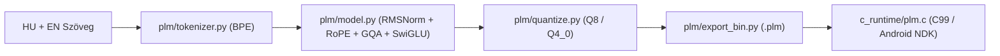

# PLM — Pocket Language Model (v0.1) 📱☕

**Nulláról épített, nyílt forráskódú, telefonra (Android / ARM64) tervezett könnyűsúlyú LLM architektúra, BPE tokenizáló, Q4/Q8 kvantáló és tiszta C99 futtatókörnyezet.**

*From-scratch, zero-dependency Pocket Language Model (temporary codename: PLM) — featuring Llama-3/Qwen-style Decoder-Only Transformer (RMSNorm, RoPE, SwiGLU, GQA, weight tying), custom Hungarian+English BPE tokenizer, Q8/Q4_0 block quantization, binary `.plm` export, and a portable C99 inference runtime.*

> **Státusz:** `v0.1` (architektúra, tokenizáló, kvantálás, bináris export és C99 runtime kész & 100%-ban tesztelve).  
> **Licenc:** Apache 2.0 · **Készítette:** Pék Richárd · [cuppashot.hu](https://cuppashot.hu)

---

## Modell-előbeállítások (Presets)

| Preset | Paraméterek | Szótár | Rétegek | Q4 méret (mobil RAM) | Cél |
|---|---:|---:|---:|---:|---|
| `tiny-test` | ~15K | 256 | 2 | < 1 MB | Azonnali CPU egységteszt |
| `nano-30m` | ~26M | 16 384 | 8 | ~14 MB | Ingyenes GPU előtanítás & validálás |
| `micro-180m` | ~158M | 32 768 | 14 | ~85 MB | Telefonos magyar+angol zseb-asszisztens |

## Architektúra



## Gyors indítás és tesztelés (Python + C99)

```bash
python3 -m unittest discover -s tests -v
```

A tesztkészlet automatikusan ellenőrzi:
1. A modell-konfigurációk paraméterszámát és mobil Q4 memórialábnyomát
2. A magyar/angol BPE tokenizáló tanítását és veszteségmentes oda-vissza kódolását
3. A Transformer előrefelé haladását (`forward`) és token-generálását
4. A Q8 és blokkos Q4_0 kvantálás pontosságát (MSE)
5. A `.plm` bináris exportot és a `c_runtime/plm.c` (`gcc -std=c99`) fordítását + futtatását!
